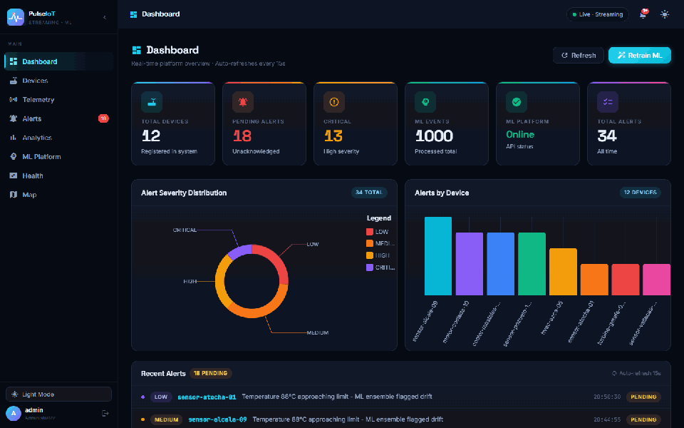
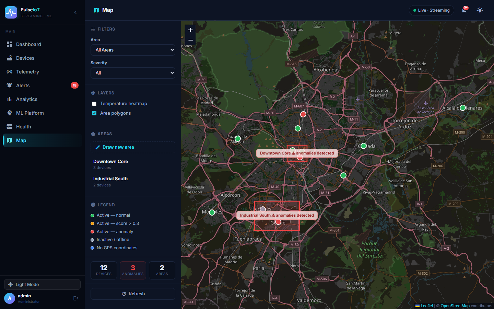
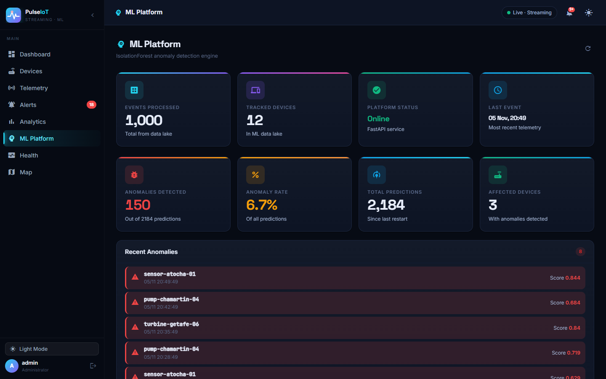
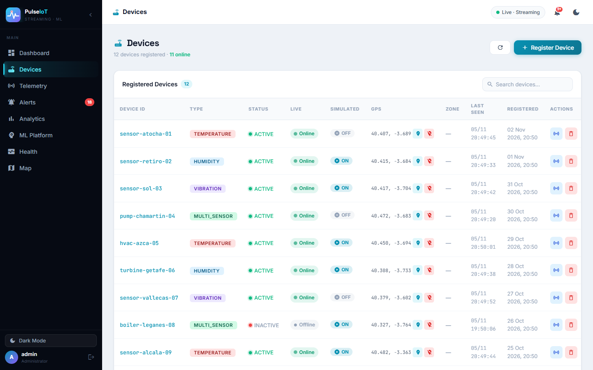
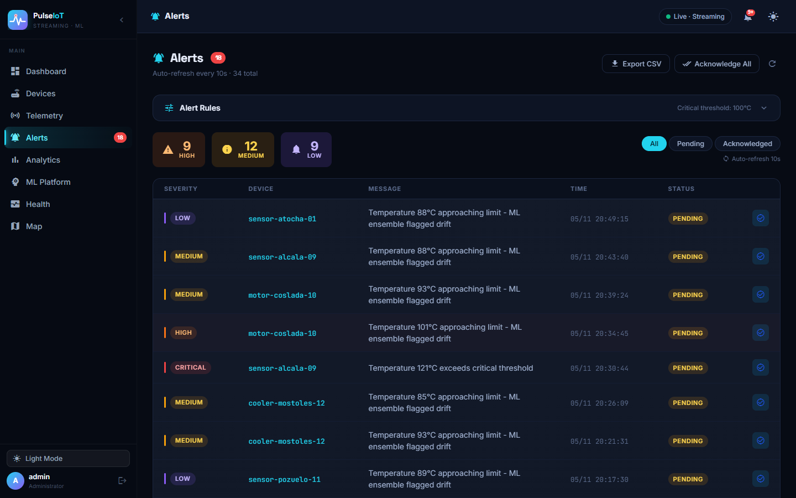

<div align="center">


# IoT Telemetry Platform with Real-Time Anomaly Detection

**Event-driven IoT platform: Kafka · Spring Boot microservices · PySpark · ML ensemble · Angular dashboard**

[](https://github.com/Francisco-B-O/PulseIoT/actions/workflows/ci.yml)

  

### [▶ Live demo](https://francisco-b-o.github.io/PulseIoT/app/) · [Project page](https://francisco-b-o.github.io/PulseIoT/)



</div>

Distributed system for collecting IoT telemetry, detecting anomalies with machine learning, and surfacing alerts through a web dashboard. Built as a personal project to work through the real complexity of event-driven distributed systems end-to-end.

> Brand assets (logo, wordmark, social preview) are in [`docs/brand`](docs/brand).
>
> The **live demo** runs the real Angular app against an in-browser mock of the API (`frontend/src/app/demo`), so it works on GitHub Pages with no backend.

**Stack:** Java 21 / Spring Boot 3.4.1 · Apache Kafka · Python 3.11 / FastAPI · PySpark · Angular 17 · Docker

<table>
<tr>
<td></td>
<td></td>
</tr>
<tr>
<td></td>
<td></td>
</tr>
</table>

---

## Architecture

9 Spring Boot microservices + a Python ML platform + a PySpark streaming service + Angular frontend, all wired together through Kafka and orchestrated with a single `docker-compose.yml`.

```
Device Simulator
      ↓ HTTP + JWT
  API Gateway (8080)
      ↓
Ingestion Service → Kafka [device-data-received]
      ↓                          ↓
Processing Service         Analytics Service
      ↓                     (Redis cache)
Kafka [device-data-processed]
      ↓                    ↓
Alert Service       Spark Streaming Service
(PostgreSQL)        (rolling window features)
                           ↓
                    Kafka [device-data-enriched]
                           ↓
                    ML Platform (Python)
                    (IF + Z-score + Trend ensemble)
                           ↓
                    Kafka [ml-predictions]
```

| Service | Port | Role |
|---------|------|------|
| gateway-service | 8080 | Entry point — JWT validation, routing, rate limiting |
| discovery-service | 8761 | Eureka service registry |
| auth-service | — | User registration, JWT generation |
| device-service | — | Device CRUD, GPS coordinates, area management |
| ingestion-service | — | Telemetry intake, Kafka producer |
| processing-service | — | Event enrichment, configurable alert rule evaluation |
| alert-service | — | Alert persistence and management |
| analytics-service | — | Per-device event counts, last-seen timestamps, telemetry history (Redis) |
| notification-service | — | Webhook/email triggers |
| spark-streaming-service | — | PySpark rolling window feature engineering |
| iot-ml-platform | 8000 | FastAPI ML server — ensemble anomaly detection, model training, real-time stats |
| frontend | 4200 | Angular dashboard |

Kafka topics: `device-data-received` → `device-data-processed` → `device-data-enriched` → `ml-predictions`, `ml-anomalies`, `alert-created`

---

## Running it

### Requirements

- Docker + Docker Compose
- ~6 GB RAM
- Ports available: `8080`, `4200`, `8000`, `8761`, `3000`, `9090`, `9411`

### Configure secrets

Secrets are **not** stored in the repo. Create a local `.env` first (it is git-ignored):

```bash
cp .env.example .env
# edit .env: JWT_SECRET (openssl rand -base64 48), POSTGRES_PASSWORD, ADMIN_PASSWORD, GRAFANA_PASSWORD
```

`docker compose` refuses to start if any of them is missing.

### Start

```bash
docker compose build --no-cache
docker compose up -d
```

All services register with Eureka in ~60–90 seconds. Check status:

```bash
docker compose ps
curl http://localhost:8761/eureka/apps
```

### Access

| What | URL | Credentials |
|------|-----|-------------|
| Frontend | http://localhost:4200 | `ADMIN_USERNAME` / `ADMIN_PASSWORD` from `.env` |
| ML API docs | http://localhost:8000/docs | — |
| Eureka | http://localhost:8761 | — |
| Grafana | http://localhost:3000 | admin / `GRAFANA_PASSWORD` |
| Prometheus | http://localhost:9090 | — |
| Zipkin | http://localhost:9411 | — |

---

## API

### Authenticate

```bash
TOKEN=$(curl -s -X POST http://localhost:8080/api/v1/auth/login \
  -H "Content-Type: application/json" \
  -d "{\"username\":\"admin\",\"password\":\"$ADMIN_PASSWORD\"}" | jq -r '.token')
```

### Register a device

```bash
curl -X POST http://localhost:8080/api/v1/devices \
  -H "Authorization: Bearer $TOKEN" \
  -H "Content-Type: application/json" \
  -d '{"deviceId":"sensor-01","type":"TEMPERATURE","latitude":40.4168,"longitude":-3.7038}'
```

### Send telemetry

```bash
curl -X POST http://localhost:8080/api/v1/telemetry \
  -H "Authorization: Bearer $TOKEN" \
  -H "Content-Type: application/json" \
  -d '{"deviceId":"sensor-01","payload":{"temperature":25.5,"humidity":55.0,"vibration":0.2}}'
```

### Check alerts

```bash
curl -H "Authorization: Bearer $TOKEN" http://localhost:8080/api/v1/alerts | jq
```

### Device analytics (event count + last seen)

```bash
curl -H "Authorization: Bearer $TOKEN" \
  http://localhost:8080/api/v1/analytics/stats/sensor-01

# Telemetry history (last 50 snapshots)
curl -H "Authorization: Bearer $TOKEN" \
  http://localhost:8080/api/v1/analytics/history/sensor-01
```

### Configure alert threshold

```bash
# Get current threshold
curl -H "Authorization: Bearer $TOKEN" http://localhost:8080/api/v1/rules/temperature

# Update threshold (e.g. 90°C critical, 72°C warning)
curl -X POST http://localhost:8080/api/v1/rules/temperature \
  -H "Authorization: Bearer $TOKEN" \
  -H "Content-Type: application/json" \
  -d '{"threshold": 90}'
```

### ML prediction and stats

```bash
# Single prediction
curl -X POST http://localhost:8000/predict \
  -H "Content-Type: application/json" \
  -d '{
    "deviceId": "sensor-01",
    "timestamp": "2026-04-03T12:00:00Z",
    "enrichedData": {"temperature": 95.0, "humidity": 10.0, "vibration": 8.0}
  }'

# Anomaly stats
curl http://localhost:8000/anomaly-stats

# Enable auto-retraining every 4 hours
curl -X POST http://localhost:8000/autotrain \
  -H "Content-Type: application/json" \
  -d '{"enabled": true, "interval_hours": 4}'
```

Full Postman collection (50+ requests) in `postman/`.

---

## ML system

**Ensemble:** Three models vote on each event — Isolation Forest (weight 2), Z-score (weight 1), Trend (weight 1). An anomaly is declared when total weighted votes ≥ 2.

| Model | Detects |
|-------|---------|
| Isolation Forest | Global statistical outliers (trained on historical Parquet data) |
| Z-score | Sensor readings deviating > 3σ from rolling mean (uses Spark features) |
| Trend | Increasing temperature trend with high variance (uses Spark features) |

**Isolation Forest features (24):** Raw sensor readings (`temperature`, `humidity`, `vibration`) plus per-device rolling statistics over a 5-event window: mean, std, min, max, delta.

**Threshold (IF):** Computed at training time as the 5th percentile of training scores, stored in `ml/models/latest_model.json`. Approximately `-0.036` on the current model.

**Retrain:** `POST http://localhost:8000/train` or via the dashboard ML section.

**Auto-retrain:** Enable via `POST http://localhost:8000/autotrain` with `{"enabled": true, "interval_hours": 4}`. A background daemon thread handles the schedule.

**Anomaly stats:** `GET http://localhost:8000/anomaly-stats` — real-time aggregates from the in-memory prediction history (last 500 predictions).

**Inference context:** Before Isolation Forest scoring, the predictor fetches the last 4 stored events for the device from the Parquet data lake and prepends them to the current event, providing a proper 5-event temporal window.

More detail in [`docs/ml.md`](docs/ml.md).

---

## Dashboard features

| Section | Key features |
|---------|-------------|
| **Dashboard** | KPIs, alert severity chart, recent alerts, 15 s auto-refresh |
| **Devices** | CRUD, telemetry modal, **Online/Offline live badge** (2-min window), **Last Seen** column, **GPS location picker** |
| **Telemetry** | Manual sensor input with sliders, presets, session history |
| **Alerts** | Severity/status filters, bulk ack, **Export CSV**, **Alert Rules panel** (runtime threshold editor) |
| **Analytics** | Event counts, bar chart, **Telemetry History line chart** (temp/humidity/vibration tabs) |
| **ML Platform** | Prediction tester, **Anomaly stats KPIs**, **Recent anomalies list**, retrain, **Auto-retrain toggle** |
| **Map** | Leaflet/OpenStreetMap map with color-coded device markers, draw/edit/delete area polygons, temperature heatmap, filters |
| **Health** | Gateway, ML, Discovery service status |
| **Topbar** | **Notification bell** with badge + dropdown of pending critical alerts, dark/light theme toggle |

---

## Project structure

```
.
├── spring-event-iot-platform/   # Java microservices (Maven multi-module)
│   ├── common/common-lib/       # Shared DTOs, exceptions, mappers
│   ├── services/                # 9 Spring Boot services
│   └── simulator/               # Device simulator
├── iot-ml-platform/             # Python ML platform
│   ├── api/                     # FastAPI server
│   ├── ingestion/               # Kafka consumer
│   ├── ml/                      # Model training and prediction
│   ├── processing/              # Feature engineering
│   ├── storage/                 # Parquet data lake
│   └── data/                    # Parquet files (partitioned by day)
├── spark-streaming-service/     # PySpark rolling window feature engineering
│   ├── streaming/               # Pure-Python feature logic + Spark processor
│   └── config/                  # Environment-based configuration
├── frontend/                    # Angular 17 dashboard
├── landing/                     # GitHub Pages project page (served from the gh-pages branch)
├── docs/                        # Architecture and API reference (+ screenshots)
├── postman/                     # API collection + environment
├── infrastructure/              # Prometheus config, Docker volumes
├── sonar-project.properties     # SonarQube analysis config
└── docker-compose.yml
```

---

## Development

### Java services

```bash
cd spring-event-iot-platform
mvn clean package -DskipTests

# Single service
mvn clean package -DskipTests --projects services/processing-service --also-make

# SonarQube analysis
mvn sonar:sonar -Dsonar.host.url=http://localhost:9000
```

### Python ML platform

```bash
cd iot-ml-platform
pip install -r requirements.txt
export PYTHONPATH=$PYTHONPATH:.

python ingestion/kafka_consumer.py   # Kafka consumer + ML pipeline
python api/app.py                    # FastAPI on :8000
python ml/train_model.py             # Retrain model
pytest                               # Tests
```

### Frontend

```bash
cd frontend
npm install
npm start                 # http://localhost:4200 (needs the backend running)
npm run build:demo        # static, backend-less demo build (mock API) -> dist/demo
npm run test:ci           # 237 unit tests, headless Chrome
```

Deep links work: `http://localhost:4200/#map`, `#ml`, `#alerts`, ...

---

## Security notes

- Secrets (JWT key, DB/Grafana/admin passwords) come from `.env`; compose fails fast if they are missing.
- The gateway validates JWTs (HS256) and enforces roles: rule updates and device/area deletion need `ROLE_ADMIN`; `/api/v1/ml/train/**` too.
- The ML API validates the same JWT: `/predict*` need a valid token, `/train` and `POST /autotrain` need `ROLE_ADMIN`. CORS is limited to `CORS_ORIGINS`. (If `JWT_SECRET` is unset it runs open, for local development only.)
- Internal services are not published on the host network; only the gateway (8080), ML API (8000), frontend and observability UIs are.
- Not production-ready yet: no TLS termination (put nginx/Traefik in front) and public self-registration is enabled.

## Design decisions

| Decision | Why | Trade-off |
|----------|-----|-----------|
| Kafka between every service | Decoupling and replay; consumers scale independently | Eventual consistency; consumers must be idempotent |
| Idempotency table per consumer (`idempotency_records`) | Kafka is at-least-once; redelivery must not create duplicate alerts or events | One extra insert per event; alert + record share one DB transaction |
| Spark computes rolling-window features, ML consumes them | Keeps feature logic stateful and reusable, model service stays simple | Extra moving part and latency (micro-batches) |
| Ensemble (IsolationForest + Z-score + trend) | Each catches a different failure mode; votes reduce false positives | Needs tuning of weights/threshold; prediction history is snapshotted to disk every 30 s (a crash can lose up to 30 s) |
| Single gateway with JWT + role checks | One place for authN/Z, CORS, rate limiting | Gateway is a single point of failure (no Resilience4j yet) |
| Frontend demo mode with an in-browser mock API | Recruiters can try the UI without running 20 containers | The demo data is simulated, not the real pipeline |

---

## Releases & branches

- `main` — stable releases (current: **v1.0.0**, see [CHANGELOG](CHANGELOG.md))
- `develop` — integration branch
- `gh-pages` — landing page + static demo (generated, do not edit)

---

## License

Released under the [MIT License](LICENSE).

## Author

**Francisco Balonero Olivera**

- GitHub: https://github.com/Francisco-B-O
- LinkedIn: https://www.linkedin.com/in/francisco-balonero-olivera/

